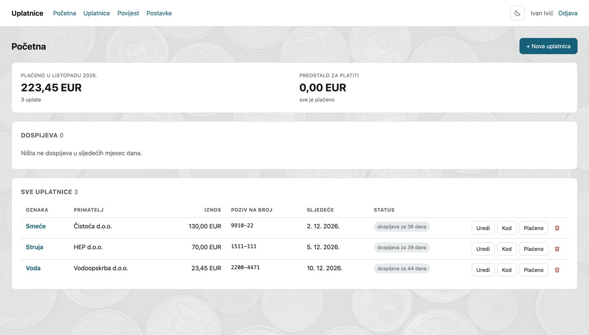
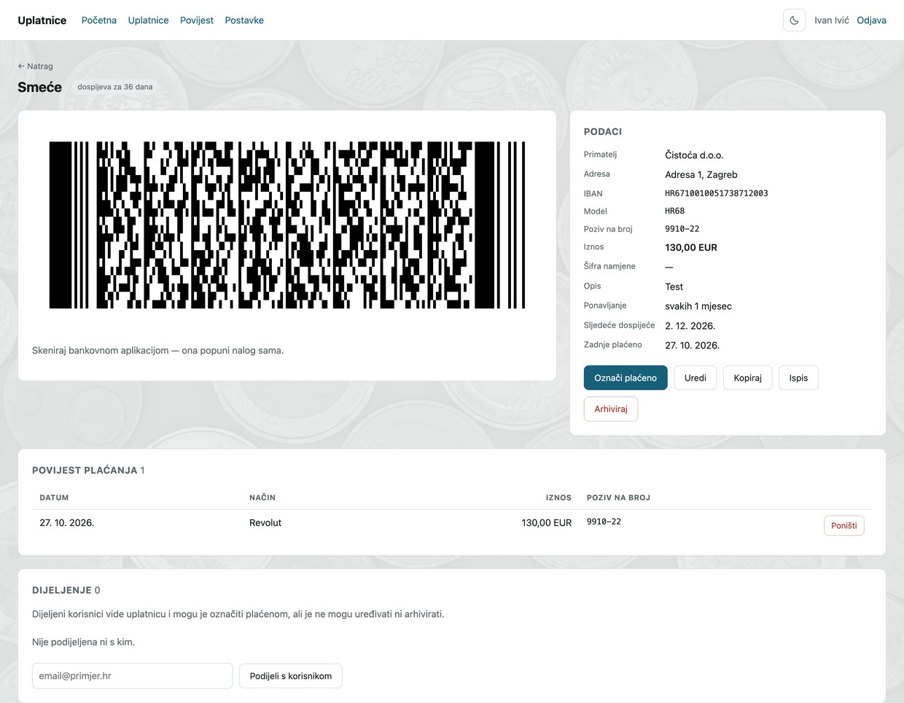
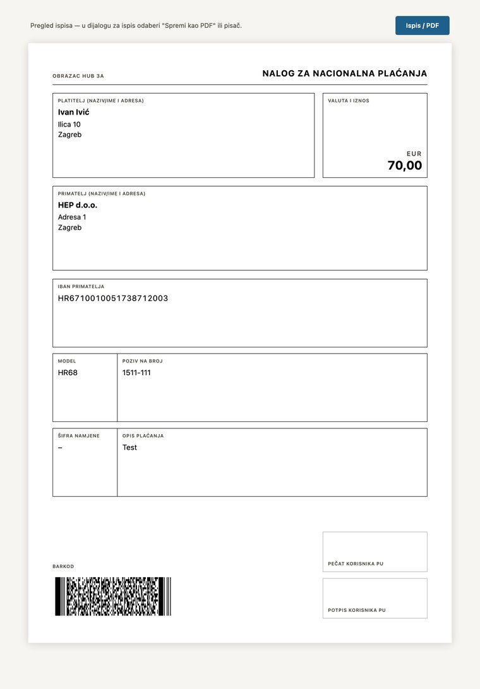
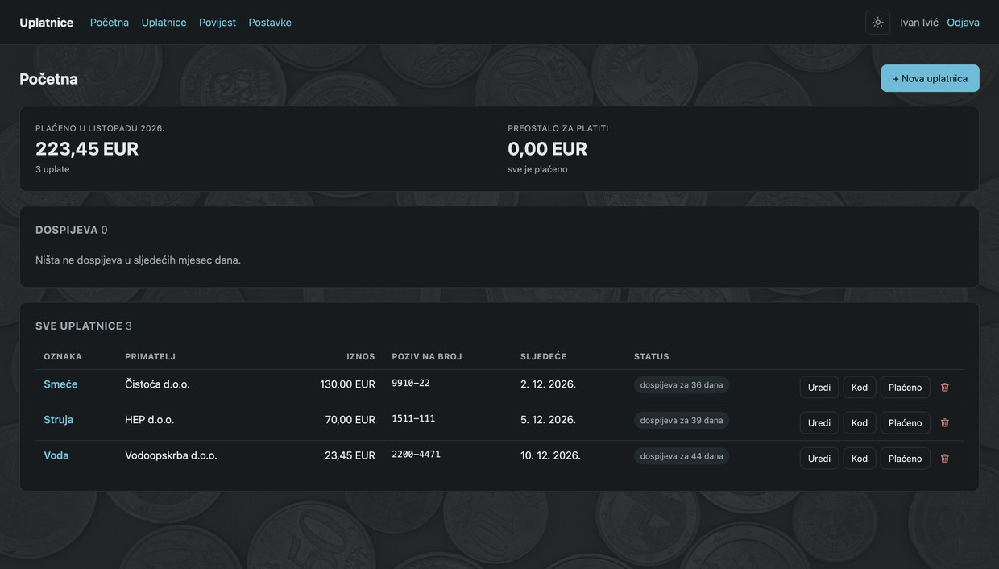

# Uplatnice WebUI

Web sučelje za hrvatske HUB 3A uplatnice. Uplatnicu spremiš jednom, plaćaš je
svaki mjesec — bez ponovnog tipkanja IBAN-a i poziva na broj.

Najvažniji dio je 2D barkod: PDF417 koji mobilna bankovna aplikacija skenira i
sama popuni nalog za plaćanje.



## Što radi

- **Uplatnice** — unos, uređivanje, kopiranje i arhiviranje; akcije su u svakom
  retku popisa (Uredi / Kod / Plaćeno / obriši)
- **Barkod** — PDF417 po specifikaciji HUB 3A, s hrvatskom dijakritikom (UTF-8)
- **Ispis** — A4 obrazac HUB 3A s barkodom, mjestom za pečat i potpis
- **Ponavljanje** — dan / tjedan / mjesec × N; dospijeće se pomiče tek kad se
  uplatnica označi plaćenom
- **Plaćanje** — bilježi način plaćanja (mobilna banka, gotovina, …); zadnja
  uplata se može poništiti, čime se vraća i dospijeće
- **Sažetak i povijest** — koliko je plaćeno u tekućem mjesecu, koliko je ostalo,
  i plaćanja po mjesecima
- **Dijeljenje** — uplatnicu možeš podijeliti s drugim korisnikom; on je vidi i
  može označiti plaćenom, ali je ne može uređivati
- **Tamni način**, IBAN provjera (sve države) uživo u formi



### Ispis i tamni način

A4 obrazac s barkodom, mjestom za pečat i potpis — dovoljno je browserovo
„Print to PDF", nema PDF biblioteke:



Tamni način prati OS postavku, a odabir se pamti:



## Stack

Namjerno mali broj pokretnih dijelova: **dvije runtime ovisnosti**, jedan proces,
jedan fajl baze.

| sloj | izbor | zašto |
|---|---|---|
| runtime | Node.js 24 | `node:sqlite` i `node:crypto` su ugrađeni |
| HTTP | Express 5 | 2 ovisnosti ukupno; ručni router bi bio više koda |
| baza | SQLite, jedan fajl, WAL | za nekoliko korisnika i desetke uplatnica |
| migracije | `ensureColumn()` u `db.js` | idempotentne, bez frameworka |
| barkod | [bwip-js](https://github.com/metafloor/bwip-js) | PDF417 → SVG, bez native builda |
| UI | server-rendered HTML | bez SPA, bez bundlera, bez build stepa |
| predlošci | `html\`...\`` u `html.js` | automatski escapea interpolacije (anti-XSS) |
| lozinke | `scrypt` (`node:crypto`) | bez bcrypt/argon2 ovisnosti |
| sesija | potpisani cookie (HMAC) | stateless, preživi restart |
| IBAN | `public/iban.js` | isti modul za server i preglednik (mod-97) |
| kontejner | Docker **ili** Podman (`Dockerfile`) | radi s oba, bez izmjena |
| HTTPS | Caddy (`Caddyfile`) | automatski Let's Encrypt |
| CI/CD | GitHub Actions | testovi na svaki push, slika na tag |

Frontend je običan HTML i CSS — nema Reacta, nema Tailwind builda, nema
transpilera. `public/style.css` je jedini stilski list aplikacije.

## Pokretanje

Za razvoj:

```bash
npm install
npm run dev            # node --watch, http://localhost:3000
npm test
```

Podaci se drže u `data/uplatnice.db` (nije u gitu).

### Kontejner

Najbrže je povući objavljenu sliku:

```bash
cp .env.example .env   # SESSION_SECRET: openssl rand -hex 32

docker pull ghcr.io/ngarafol/uplatnice-webui:latest

docker run -d --name uplatnice \
  -p 3000:3000 \
  --env-file .env \
  -v uplatnice-data:/app/data \
  ghcr.io/ngarafol/uplatnice-webui:latest

docker logs -f uplatnice
```

Slike se objavljuju za `amd64` i `arm64`, s oznakama `latest`, `0`, `0.1` i
`0.1.0`. Na serveru radije prikvači točnu verziju (`:0.1.0`) nego `latest` —
inače `pull` tiho donese drugu sliku.

Isto radi s Podmanom — zamijeni `docker` s `podman`.

Baza živi u imenovanom volumenu `uplatnice-data`, pa preživljava brisanje
kontejnera i obnovu slike.

#### Gradnja iz izvora

Ako želiš sam graditi (ili mijenjati kod), `Dockerfile` je standardan pa rade i
`docker build .` i `podman build .`, bez ikakvih zastavica:

```bash
docker build -t uplatnice-webui .
docker run -d --name uplatnice -p 3000:3000 --env-file .env \
  -v uplatnice-data:/app/data uplatnice-webui
```

<details>
<summary>Ako imaš <code>make</code> — skraćenice</summary>

`make` sam prepozna je li instaliran Podman ili Docker (`ENGINE=docker` /
`ENGINE=podman` nadjačava). Naredbe rade isto, samo su kraće:

| | |
|---|---|
| `make build` / `make run` / `make stop` | gradnja i životni ciklus kontejnera |
| `make logs` / `make shell` / `make ps` / `make health` | pregled |
| `make backup` | kopija baze u `backups/` (vidi dolje) |
| `make proxy` / `make proxy-stop` | Caddy s HTTPS-om |
| `make release VERSION=x.y.z` | tag + push (pokreće objavu) |

</details>

### Javni server

Upiši domenu u `Caddyfile` i postavi `SECURE_COOKIES=true` u `.env`, pa pokreni
aplikaciju i Caddy:

```bash
docker run -d --name uplatnice-proxy --network host \
  -v "$PWD/Caddyfile:/etc/caddy/Caddyfile:ro" \
  -v uplatnice-caddy-data:/data \
  -v uplatnice-caddy-config:/config \
  caddy:2
```

Caddy sam pribavlja i obnavlja Let's Encrypt certifikat.

### Sigurnosna kopija

Baza je u WAL modu, pa obična kopija datoteke može biti nepotpuna. Kopija se
radi `VACUUM INTO` unutar kontejnera:

```bash
docker exec uplatnice node -e 'const {DatabaseSync}=require("node:sqlite");const db=new DatabaseSync("/app/data/uplatnice.db");db.prepare("VACUUM INTO ?").run("/tmp/kopija.db");db.close();'
docker cp uplatnice:/tmp/kopija.db ./uplatnice-$(date +%F).db
docker exec uplatnice rm -f /tmp/kopija.db
```

Ili `make backup`, koje to isto spremi u `backups/`.

## Izdavanje verzije

```bash
make release VERSION=1.0.0
```

Tag pokreće GitHub Actions: gradi sliku za `amd64` i `arm64` i pusha je u
`ghcr.io/<korisnik>/<repo>` s oznakama `1.0.0`, `1.0`, `1`, `latest`, pa otvori
GitHub Release s popisom promjena. Push na `main` bez taga vrti samo testove i
probnu gradnju.

## O HUB 3A barkodu

Barkod nosi 14 polja odvojenih prijelazom retka, s zaglavljem `HRVHUB30`
(implementacija: `hub3.js`). Dužine polja i dozvoljeni znakovi uzeti su iz
službene upute HUB-a (v6):

- platitelj 30, adresa platitelja 27, primatelj 25, adresa primatelja 25,
  mjesto 27, IBAN 21, model 4, poziv na broj 22, šifra namjene 4, opis 35
- kodna stranica je UTF-8, pa `Č Ć Đ Š Ž` ostaju u barkodu
- dozvoljeni znakovi: `0–9`, hrvatska abeceda, `Q W X Y`, razmak, te
  `, . : - + ? ' / ( )`

Polje IBAN-a ima 21 znak, što odgovara hrvatskom IBAN-u. Strani IBAN-i se mogu
spremiti (provjeravaju se po ISO 13616, s duljinom po državi), ali takav barkod
izlazi izvan HUB 3A obrasca i bankovna aplikacija ga može odbiti — aplikacija to
naznači na detalju uplatnice.

## Struktura

```
server.js        ulaz: express, statika, sesija, rute
routes.js        sve rute
db.js            shema, migracije, upiti
hub3.js          14-poljni payload + validacija
public/iban.js   IBAN: normalizacija, zapis, mod-97 (server i preglednik)
barcode.js       PDF417 -> SVG
recurring.js     datumi, intervali, nazivi mjeseci
auth.js          scrypt, potpisani cookie
html.js          html`...` predložak s auto-escapingom
views.js         sve stranice
views-ispis.js   A4 obrazac HUB 3A
public/          style.css, print.css, pozadina.jpg
test/            node:test, bez frameworka
```

## Napomene

- Pozadinska fotografija: [Pexels](https://www.pexels.com/photo/37416581/),
  Pexels License (besplatno, bez obavezne atribucije), monokromatski obrađena.
- Kôd je pisan za osobnu upotrebu; nema višerazinskih uloga ni revizijskog traga.
